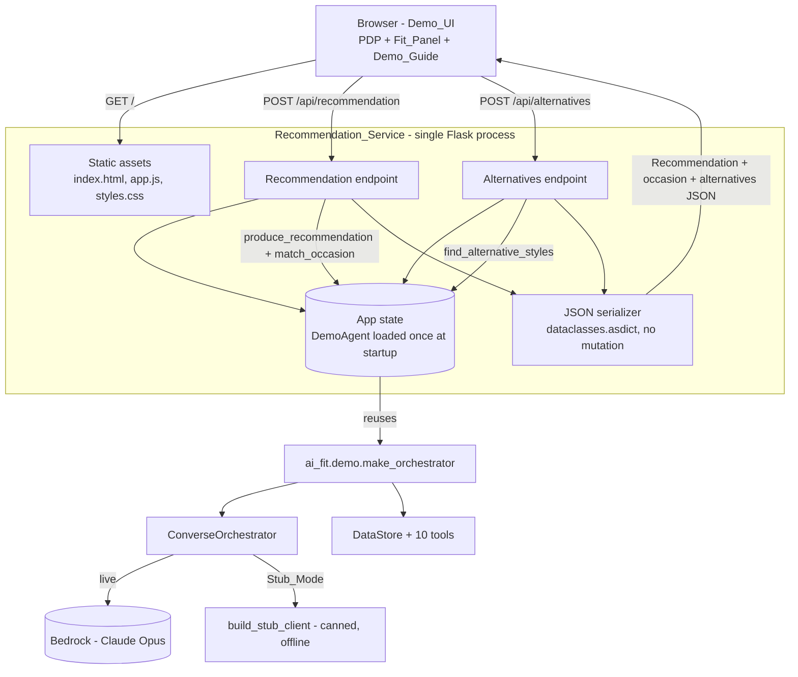
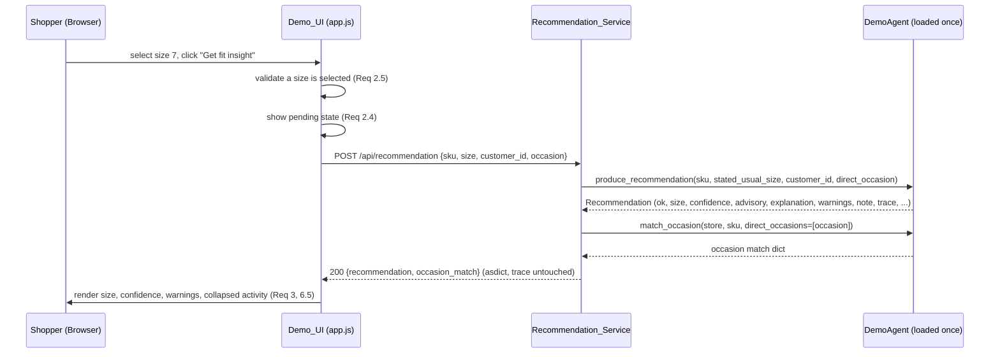
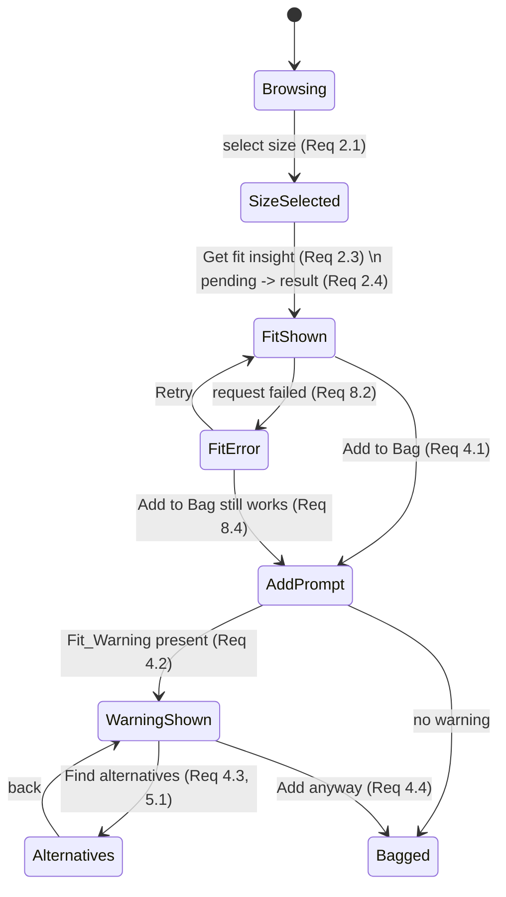

# Design Document

## Overview

AI Fit Demo UI is a browser-based demonstration surface for the existing AI Fit agent. It renders a simulated ALDO product detail page (PDP) and layers the agent's size recommendation, confidence, occasion match, alternative styles, and masked reasoning trace onto that page through an "ALDO FIT" assistant panel. The audience watches the agent reason over a realistic storefront interaction.

The feature is deliberately thin. It adds **no fit logic**. Every recommendation, occasion result, alternative list, and reasoning trace comes from the already-built `ai_fit` package: `ConverseOrchestrator.produce_recommendation` and the `match_occasion` / `find_alternative_styles` tools. This design covers only two things:

1. **Recommendation_Service** — a thin HTTP layer that loads the agent once at startup, exposes two JSON endpoints that call the existing orchestrator and tools, and serves the Demo_UI static assets so the whole demo runs from a single process.
2. **Demo_UI** — a static browser page (HTML/CSS/vanilla JS) that renders the simulated PDP, the Fit_Panel, and the Demo_Guide, and drives the scripted demo flow by calling the two endpoints.

The core design challenge is **faithful pass-through without leakage**: the service must serialize the agent's existing result objects into JSON exactly as produced — preserving the masked trace, never adding or unmasking a Protected_Attribute — and the UI must render them without re-deriving or inventing any fit judgment. The design resolves this by (a) serializing the `Recommendation` dataclass and the tool result dicts field-for-field with no transformation, (b) relying on the agent's own masking (`customer_uid` / `cnsmr_prof_sid` are already redacted in `trace`, and `get_customer_profile` already strips protected attributes at the data layer), and (c) keeping the browser a pure renderer of server-supplied JSON.

### Grounding in the existing agent

The design is pinned to the real interfaces in the workspace, not an idealized version:

| Existing symbol | Module | Used by the service for |
|---|---|---|
| `ConverseOrchestrator.produce_recommendation(sku, *, stated_usual_size?, customer_id?, direct_occasion?, request_type?) -> Recommendation` | `ai_fit.orchestrator.converse` | Requirement 7.1 recommendation endpoint |
| `Recommendation` dataclass (`ok, recommended_size, confidence, advisory, explanation, supporting_signal_count, warnings, note, trace, failure_reason`) | `ai_fit.orchestrator.converse` | Requirements 3, 6, 8 serialization |
| `match_occasion(store, sku, *, profile_occasions?, direct_occasions?, include_review_cues?) -> dict` | `ai_fit.tools.alternatives` | Requirement 5.4 occasion match |
| `find_alternative_styles(store, requested_occasion, browsed_sku) -> dict` | `ai_fit.tools.alternatives` | Requirements 5.1–5.3, 5.5 |
| `make_orchestrator(client=None, *, dataset_paths=None) -> DemoAgent` and `build_stub_client(...)` | `ai_fit.demo` | Requirements 7.3, 8.3, 9.2, 9.3 startup wiring + Stub_Mode |
| `ReasoningTrace.full_trace()` dict (`steps, validator_corrections, customer_facing_explanation, failed_tools, masked_fields`) | `ai_fit.trace.builder` | Requirement 6 trace rendering |

The service reuses `ai_fit.demo.make_orchestrator` and `build_stub_client` verbatim, so the agent wiring, the data-layer protected-attribute stripping, and the stub-vs-live seam are inherited rather than re-implemented.

### Key design decisions and rationale

| Decision | Rationale |
|---|---|
| Thin HTTP layer only; zero fit logic in the service or the browser | Requirement intro and 7: all judgment stays in `ai_fit`; the UI is a presentation surface. Avoids a second source of truth. |
| Reuse `ai_fit.demo.make_orchestrator` for startup wiring, loaded **once** | Requirement 7.3 forbids per-request data-store reload; `make_orchestrator` already loads the store once and binds the 10 tools. |
| Serialize the `Recommendation` dataclass field-for-field (`dataclasses.asdict`) with no mutation | Requirement 7.4: no added/removed/altered Protected_Attribute, no trace unmasking. The agent already masks `trace`; the service must not touch it. |
| Flask as the single web dependency, pinned exactly | Requirement 9.4: exactly one documented web framework pinned to an exact version. Flask serves both JSON and static files from one process (Requirement 7.5) and starts with one command (Requirement 9.1). |
| Vanilla HTML/CSS/JS for the Demo_UI (no front-end framework/build step) | Keeps the "single documented web framework dependency" literally true — no npm/bundler — and makes the demo start instantly. The browser only fetches JSON and renders it. |
| Stub_Mode selected by env var / flag, delegating to `build_stub_client` | Requirements 8.3, 9.2: offline demo with the existing stubbed Converse client and no live AWS, no production-CSV dependency on Bedrock. |
| Browser renders only server JSON; pending/error/retry handled client-side | Requirements 2.4, 8.2, 8.4: non-blocking failure states and a usable page even when a request fails. |

## Architecture

### High-level architecture



### Request lifecycle (fit insight)



### Separation of concerns

- **Recommendation_Service (Python/Flask)** — owns process lifecycle, startup wiring (load the `DemoAgent` once), request parsing, calling the existing orchestrator/tools, serializing their results unchanged, and serving static assets. It contains no sizing, occasion, or masking logic of its own.
- **Demo_UI (browser)** — owns all presentation: the PDP layout, size grid, Fit_Panel, Demo_Guide, add-to-bag flow, pending/error/retry states, and the collapsible activity (trace) rendering. It never computes a recommendation; it renders what the service returns.
- **`ai_fit` package (unchanged dependency)** — owns all fit/occasion/alternative reasoning, protected-attribute stripping, and trace masking. This feature does not modify it.

## Components and Interfaces

### Recommendation_Service (Python module: `ai_fit_demo_ui/service.py`)

A small Flask application. One `DemoAgent` is created at startup via `ai_fit.demo.make_orchestrator(client)` — where `client` is `None` for live Bedrock or `build_stub_client(...)` for Stub_Mode — and stored on the app so every request reuses the same loaded `DataStore` and bound tools (Requirement 7.3). The browsed product configuration (SKU, name, price, color options, image, offered sizes) and the demo customer identifier/occasion are read from a small config block at startup.

```python
# Startup (once)
def create_app(*, stub: bool, product_config: ProductConfig) -> Flask: ...
# builds DemoAgent via make_orchestrator; stores agent, product_config on app

# Endpoints
POST /api/recommendation
    body: {"sku": str, "size": number, "customer_id": str, "occasion": str}
    -> 200 {"recommendation": {...Recommendation fields...},
            "occasion_match": {...match_occasion dict...}}
    -> 400 {"error": "size_required"}            # missing/invalid size (defensive; UI also guards, Req 2.5)
    -> 503 {"error": "...", "retryable": true}   # unexpected service error (Req 8.2)

POST /api/alternatives
    body: {"sku": str, "occasion": str}
    -> 200 {"alternatives": {...find_alternative_styles dict...}}
    -> 503 {"error": "...", "retryable": true}

GET /                 -> index.html (Demo_UI)
GET /static/<asset>   -> app.js, styles.css, product image, etc.
GET /api/config       -> {"product": {...}, "customer_summary": {...}, "disclaimer": str, "demo_steps": [...]}
```

Endpoint behavior:

- **`/api/recommendation`** maps the body to `produce_recommendation(sku, stated_usual_size=size, customer_id=customer_id, direct_occasion=occasion)` and separately calls `match_occasion(store, sku, direct_occasions=[occasion])`. It serializes the returned `Recommendation` with `dataclasses.asdict` (no field added, removed, or altered) and attaches the occasion-match dict (Requirements 7.1, 7.4). When `recommendation.ok` is `False`, the service still returns `200` with the `Recommendation` serialized (including `failure_reason`); it does not fabricate a size/confidence — the UI decides how to present the failure (Requirement 8.1).
- **`/api/alternatives`** calls `find_alternative_styles(store, occasion, sku)` and returns its dict unchanged (Requirements 5.1–5.5).
- **`/api/config`** returns the static product configuration, a Protected_Attribute-free customer summary (usual size + comfort priority only), the Prototype_Disclaimer text, and the ordered Demo_Guide steps, so the browser renders the PDP from server config rather than hard-coding it.
- Any unexpected exception in an endpoint is caught and returned as a `503` with `retryable: true` and a short message — never a stack trace — so the UI can show a non-blocking error and offer retry (Requirement 8.2).

The customer summary in `/api/config` is derived from `get_customer_profile` (via the loaded store), which already excludes protected attributes; the service forwards only `usual_shoe_size` and `comfort_style_priority` (Requirements 1.5, 2.2).

### JSON serialization contract

`Recommendation` is a frozen dataclass; the service serializes it with `dataclasses.asdict`, which recursively copies `trace` (already a plain masked dict from `ReasoningTrace.full_trace()`). The service performs **no** key renaming, filtering, or value transformation, which is what guarantees Requirement 7.4 (no Protected_Attribute added/removed/altered; trace not unmasked). Floats (`recommended_size`) and `None` values serialize naturally to JSON numbers / `null`.

```jsonc
// POST /api/recommendation -> 200
{
  "recommendation": {
    "ok": true,
    "recommended_size": 8.0,
    "confidence": "high",
    "advisory": false,
    "explanation": "This style has a strong history of running small ...",
    "supporting_signal_count": 102,
    "warnings": ["This style runs narrow; consider the roomier toe box."],
    "note": null,
    "trace": {
      "steps": [ { "order": 1, "step_type": "tool_invocation", "tool_name": "get_sku_fit_signals", "data_summary": {...}, "decision": null }, ... ],
      "validator_corrections": [ { "invariant": "...", "proposed_value": ..., "corrected_value": ... } ],
      "customer_facing_explanation": "...",
      "failed_tools": [ { "tool_name": "...", "unavailable_data": "..." } ],
      "masked_fields": ["customer_uid", "cnsmr_prof_sid"]
    },
    "failure_reason": null
  },
  "occasion_match": {
    "status": "match",
    "matched_occasions": ["work"],
    "customer_occasions": ["work"],
    "sku_occasions": ["work", "everyday wear", "special occasion"],
    "review_cues_used": [],
    "unrecognized_values": [],
    "message": "This product matches your occasion: work."
  }
}
```

### Demo_UI (browser: `index.html`, `app.js`, `styles.css`)

A single page rendered from `/api/config` and the two POST endpoints. Structure:

- **PDP region** — product image, name, price, color swatches, and the **size grid** of selectable controls built from `product.offered_sizes` (Requirements 1.1, 1.2). Selecting a size records it as the Stated_Usual_Size for the next fit request (Requirement 2.1).
- **Prototype_Disclaimer banner** — shown on load, stating the page is an unofficial hackathon prototype and not an ALDO storefront (Requirement 1.3).
- **Demo_Guide strip** — the ordered demo steps from `/api/config`, with a hide control (Requirement 1.4).
- **Fit_Panel ("ALDO FIT")** — shows the demo customer's fit summary (usual size + comfort priority only; no Protected_Attribute, Requirements 1.5, 2.2), a "Get fit insight" control, the recommendation result, Fit_Warnings, and the collapsible "activity" (trace) section.
- **Add to Bag flow** — an "Add to Bag" control; adding surfaces any Fit_Warning at the point of adding, with "Find alternatives" and "Add anyway" options (Requirement 4).
- **Alternatives region** — renders the `find_alternative_styles` result (0–3 entries) and the occasion-match result.

Client state is a small object: `{ selectedSize, lastRecommendation, lastOccasionMatch, pending, lastError }`. The JS never computes fit; it only reflects this state into the DOM.

#### UI rendering map (requirement → DOM behavior)

| UI behavior | Source field(s) | Requirement |
|---|---|---|
| Recommended size, confidence, explanation | `recommendation.recommended_size`, `.confidence`, `.explanation` | 3.1 |
| Advisory framing | `recommendation.advisory === true` → "advisory" label/style | 3.2 |
| Supporting evidence count | `recommendation.supporting_signal_count` | 3.3 |
| Fit_Warnings | each of `recommendation.warnings` + `recommendation.note` | 3.4, 4.2 |
| Highlight size mismatch | compare `recommended_size` vs `selectedSize` | 3.5 |
| Fit insight pending state | client `pending` flag; prior result hidden while pending | 2.4 |
| "Select a size" prompt | client guard when `selectedSize == null` | 2.5 |
| Fit_Warning at add-to-bag + find-alternatives option + proceed anyway | `warnings`/`note` present at add time | 4.2, 4.3, 4.4 |
| Alternatives list (name/price/occasions), ≤3 | `alternatives.alternatives[]` (already capped at 3 by the tool) | 5.2, 5.5 |
| "No alternatives available" | `alternatives.none_available === true` | 5.3 |
| Occasion match naming | `occasion_match.status`, `.matched_occasions` | 5.4 |
| Collapsible activity, default collapsed | `recommendation.trace` rendered under a toggle, initially closed | 6.1, 6.5 |
| Ordered steps, tools, validator corrections | `trace.steps[]`, `trace.validator_corrections[]` | 6.2 |
| Masked identifiers shown as received | `trace` already redacted; render placeholder verbatim | 6.3 |
| Failed tool / unavailable data | `trace.failed_tools[]` | 6.4 |
| Failure message (ok false) | `recommendation.failure_reason` / `.explanation`; no size/confidence shown | 8.1 |
| Non-blocking error + retry | client `lastError`; retry re-issues the POST | 8.2 |
| Page usable after failure | size selection + add-to-bag remain enabled | 8.4 |

### Add-to-bag and alternatives flow



## Data Models

The service introduces one small configuration model and otherwise passes the agent's existing models through as JSON. It does not define new fit/occasion models.

### ProductConfig (service-side startup config)

```
ProductConfig {
  sku: str                 # the single demo SKU (must exist in the catalog)
  name: str
  price_usd: float
  color_options: [str]
  image_path: str          # served from /static
  offered_sizes: [float]   # the size grid; sourced from the catalog entry's offered_sizes
  demo_occasion: str       # the demo customer's occasion (e.g. "work")
  demo_customer_id: str    # e.g. "ALDO_SYN_0005"
}
```

`offered_sizes` is read at startup from `get_product_catalog_entry(store, sku).offered_sizes` so the size grid matches the agent's view of the SKU, falling back to a configured list only if the catalog has none.

### DemoUIConfig (`GET /api/config` response)

```
{
  product: ProductConfig (minus internal ids not needed by the browser),
  customer_summary: { usual_shoe_size: float, comfort_style_priority: str },  # Protected_Attribute-free (Req 1.5, 2.2)
  disclaimer: str,                                                             # Prototype_Disclaimer (Req 1.3)
  demo_steps: [str]                                                            # Demo_Guide ordered steps (Req 1.4)
}
```

### Pass-through models (owned by `ai_fit`, serialized unchanged)

- **Recommendation** — `ai_fit.orchestrator.converse.Recommendation`, serialized via `dataclasses.asdict`. Fields exactly as the agent produces them (Requirement 7.4).
- **Occasion match** — the dict from `match_occasion` (`status, matched_occasions, customer_occasions, sku_occasions, review_cues_used, unrecognized_values, message`).
- **Alternatives** — the dict from `find_alternative_styles` (`requested_occasion, alternatives[], none_available, message`), already capped at three.
- **Masked trace** — `recommendation.trace`, the dict from `ReasoningTrace.full_trace()`; `masked_fields` is `["customer_uid", "cnsmr_prof_sid"]` and those values are already redacted upstream.

### Client state (browser)

```
UIState {
  selectedSize: number | null,
  config: DemoUIConfig | null,
  lastRecommendation: object | null,   # the recommendation sub-object
  lastOccasionMatch: object | null,
  lastAlternatives: object | null,
  pending: boolean,                     # fit request in flight (Req 2.4)
  lastError: string | null,             # non-blocking error (Req 8.2)
  activityExpanded: boolean             # trace toggle, default false (Req 6.5)
}
```

## Error Handling

| Condition | Handling | Requirement |
|---|---|---|
| Fit insight activated with no size selected | UI blocks the request, prompts "please select a size"; no POST issued | 2.5 |
| Recommendation request in flight | UI shows pending state; prior result is hidden/greyed so it is not read as current | 2.4 |
| Agent returns `Recommendation.ok == false` | Service returns the serialized failure (`failure_reason`) at `200`; UI shows the customer-facing failure message and shows no size/confidence | 8.1 |
| Service unreachable / non-2xx / network error | UI shows a non-blocking error banner with a Retry action; page stays usable | 8.2, 8.4 |
| Unexpected exception inside an endpoint | Caught; returned as `503 {error, retryable:true}` with no stack trace | 8.2 |
| Alternatives: none available | `find_alternative_styles` returns `none_available: true`; UI shows explicit "no alternatives currently available" | 5.3 |
| Occasion needs/unavailable/sku_not_found | `match_occasion` status surfaced in the UI message | 5.4 |
| Running in Stub_Mode | `make_orchestrator(build_stub_client(...))`; no live AWS, no Bedrock dependency; fixture/stub decision drives the loop offline | 8.3, 9.2 |
| Trace contains a failed tool | `trace.failed_tools[]` rendered as "tool failed / data unavailable" | 6.4 |

## Responsible AI preservation

The feature inherits, and must not weaken, the agent's Responsible-AI guarantees:

- **No Protected_Attribute on screen** — the service forwards only `usual_shoe_size` and `comfort_style_priority` for the customer summary, and `get_customer_profile` already strips age/gender/ethnicity/nationality/location at the data layer. The `/api/config` and `/api/recommendation` payloads carry no protected field (Requirements 1.5, 2.2).
- **Masked trace only** — the service serializes `recommendation.trace` unchanged; `customer_uid` and `cnsmr_prof_sid` are already redacted to `***MASKED***` by the trace builder, and the UI renders the placeholder verbatim rather than attempting to resolve it (Requirements 6.3, 7.4).
- **No fabricated results** — when `ok` is false the UI shows the failure and withholds any size/confidence, so a failure is never dressed up as a recommendation (Requirement 8.1).

## Deployment and run mode

- **Single command** — `python -m ai_fit_demo_ui` (or `flask --app ai_fit_demo_ui.service run`) starts the one process serving both the API and the static Demo_UI (Requirements 9.1, 7.5).
- **Stub_Mode** — selected by `AI_FIT_DEMO_STUB=1` or a `--stub` flag; the service builds the agent with `build_stub_client(...)` so the demo runs offline with no AWS and no Bedrock call (Requirements 8.3, 9.2).
- **Live mode** — the default; `make_orchestrator(None)` uses the existing `BotoBedrockConverseClient` wiring unchanged (Requirement 9.3).
- **Dependencies** — exactly one new, documented web framework dependency pinned to an exact version: `Flask==3.0.3`, added to `pyproject.toml` and `requirements.txt` alongside the existing `ai_fit` deps. No front-end build toolchain is introduced; the Demo_UI is static HTML/CSS/JS served by Flask (Requirement 9.4).

## Testing Strategy

Property-based testing is **not appropriate** for this feature and is intentionally omitted. The feature is a presentation surface plus a thin pass-through HTTP layer: it renders UI and forwards the existing agent's results without transforming them. There is no pure function with a meaningful "for all inputs X, property P(X) holds" statement to assert — all fit/occasion/alternative logic (and its property-based tests) already lives in the `ai_fit` spec. The appropriate strategies here are serialization/contract tests, example-based endpoint tests, and example-based UI/integration tests, per the design guidance for UI rendering and CRUD-style pass-through layers.

### Serialization / contract tests (service)

- **No mutation of the `Recommendation`**: given a known `Recommendation` (including a populated masked `trace`), assert the `/api/recommendation` JSON equals `dataclasses.asdict(recommendation)` for the recommendation sub-object — no key added, removed, or renamed, and `trace.masked_fields` and the redaction placeholder preserved exactly (Requirement 7.4).
- **No Protected_Attribute leakage**: assert the `/api/config` and `/api/recommendation` payloads contain none of the protected keys (age, gender, ethnicity, nationality, location) at any nesting depth (Requirements 1.5, 2.2).
- **Failure pass-through**: given `Recommendation(ok=False, failure_reason=...)`, assert the response carries the failure fields and no fabricated size/confidence (Requirement 8.1).

### Example-based endpoint tests (service, Stub_Mode)

Run against an app built with `build_stub_client` so no AWS is touched (Requirement 8.3):

- `POST /api/recommendation` with a valid body returns `200` with both `recommendation` and `occasion_match`; the orchestrator is the shared one loaded at startup (assert the store is not reloaded per request — Requirement 7.3, e.g. by asserting a single load call / shared object identity).
- `POST /api/recommendation` missing a size returns `400 {error:"size_required"}` (defensive guard behind the UI, Requirement 2.5).
- `POST /api/alternatives` returns the `find_alternative_styles` dict; the none-available case returns `none_available: true` (Requirements 5.1–5.3).
- An endpoint that raises internally returns `503 {retryable:true}`, not a stack trace (Requirement 8.2).
- `GET /` serves the Demo_UI HTML and `GET /static/app.js` serves the script (single-process static serving, Requirement 7.5).
- Startup in Stub_Mode performs no Bedrock/network call (Requirements 8.3, 9.2).

### UI / integration tests (browser behavior)

Lightweight DOM-level tests (or a scripted browser check) covering the rendering map and flow:

- Size selection records the size and enables fit insight; activating with no size shows the prompt and issues no request (Requirements 2.1, 2.5).
- Pending state hides the prior result during a request (Requirement 2.4).
- A recommendation renders size, confidence, explanation, supporting-signal count, advisory framing, warnings, and a highlighted mismatch when `recommended_size != selectedSize` (Requirements 3.1–3.5).
- Add-to-bag with a warning present surfaces the warning, offers "Find alternatives", and allows "Add anyway" (Requirements 4.2–4.4).
- Alternatives render ≤3 entries with name/price/occasions, and the none-available message when empty (Requirements 5.2, 5.3, 5.5).
- The activity section defaults collapsed, expands to show ordered steps/tools/validator corrections, renders the redaction placeholder verbatim, and shows failed-tool/unavailable-data entries (Requirements 6.1–6.5).
- A failed request shows a non-blocking error with Retry, and size selection + add-to-bag remain usable (Requirements 8.2, 8.4).

### Smoke test

- Single-command startup in Stub_Mode followed by one `POST /api/recommendation` produces a `200` with a recommendation and a visible masked trace, and the Prototype_Disclaimer and Demo_Guide are present in the served page (Requirements 9.1, 1.3, 1.4).
