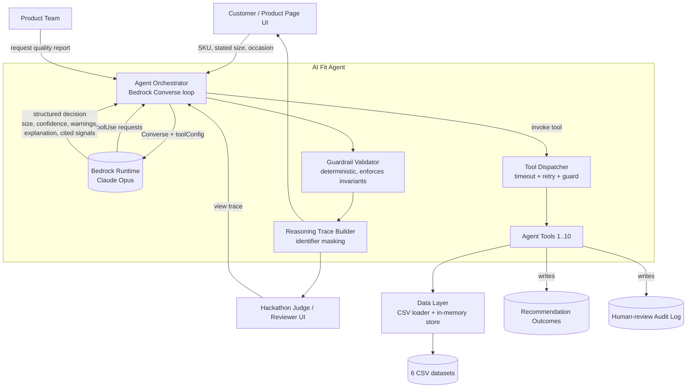
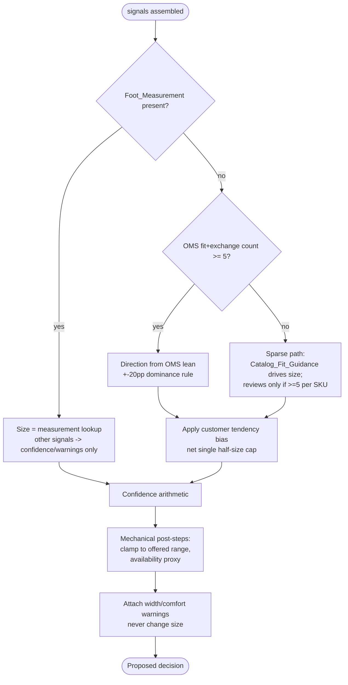

# Design Document

## Overview

AI Fit is an agentic assistant that recommends a better-fitting size for a specific SKU, assesses whether a product suits a customer's occasion, suggests alternative styles when it does not, and produces a product-quality report for the internal team. It is built end-to-end on AWS Bedrock with Claude Opus as the reasoning model, driven through the Bedrock Converse API using tool use. Claude performs genuine agentic tool-calling: it decides which data-access tools to invoke, reads the returned records, and reasons over them. Datasets are never stuffed into the prompt (Requirement 9.2, 9.3).

The core engineering challenge the requirements leave open is that many signals (OMS returns, exchanges, customer fit tendencies, catalog guidance, reviews, foot measurement) can all point at a size, and they can agree, disagree, or compound. This design resolves that by having **Claude Opus itself make the size/confidence decision** as part of its agentic reasoning. After calling the data tools, Claude reasons over all the signals (OMS returns/exchanges, exchange direction, customer fit profile, foot measurement, catalog `fit_guidance`/`fit_return_rate`/`toe_box`, reviews, and prior recommendation outcomes) and produces the `Recommended_Size`, `Confidence_Level`, any width/comfort warnings, the cited signals, and the plain-language explanation in a single structured reasoning step. That reasoning is governed by two things: (a) a strict **scoring rubric embedded in the system prompt** that encodes the signal precedence, the net single half-size cap, the OMS dominance rule, the sparse fallback, and the confidence arithmetic; and (b) **temperature 0** for near-deterministic generation. A deterministic **Guardrail Validator** then runs over Claude's structured output and enforces the hard invariants as a backstop — correcting or rejecting any violation before the recommendation reaches the customer. This is the "Claude reasons, with guardrails + low temperature" model: the LLM owns the judgment; the validator guarantees the invariants.

This design makes several ambiguities in the requirements explicit and resolves them:

1. **Signal precedence** — a strict order for which signal determines size.
2. **Half-size stacking** — OMS lean and customer tendency never compound into a full size.
3. **Measurement vs OMS tie-break** — measurement sets the size; everything else only adjusts confidence/warnings.
4. **Confidence arithmetic** — a base tier from OMS volume, then ordered, capped adjustments.
5. **Stock** — no inventory column exists in any dataset; the prototype uses an availability proxy.

### Key design decisions and rationale

| Decision | Rationale |
|---|---|
| Claude makes the size/confidence decision under a rubric at temperature 0, with a deterministic validator enforcing hard invariants | Keeps the judgment in the model's agentic reasoning (where it can weigh conflicting signals holistically) while a strict rubric + temperature 0 make it near-deterministic, and a downstream Guardrail Validator clamps outputs into the allowed discrete space so Requirement 10.4's identical-output-for-identical-signals guarantee holds in practice. |
| One tool per data source | Requirement 9.2 requires dedicated per-source tools and forbids prompt-stuffing. |
| Net single half-size cap from non-measurement signals | Requirements 1.5/1.6/1.12/1.13 each independently push a half size; naively summed they produce a full-size error. The requirements intend a direction, not accumulation. |
| Catalog presence = available | No dataset carries stock; documented as a prototype proxy with real-time stock as future work (Req 1.9, 6.1, 6.3). |
| CSV-backed in-memory store | Hackathon-pragmatic; the loader abstracts the source so a real OMS/catalog service can replace it without touching the reasoning or validator layers. |

## Architecture

### High-level architecture



### Request lifecycle (size + occasion recommendation)

```mermaid
sequenceDiagram
    participant C as Customer UI
    participant O as Orchestrator
    participant B as Bedrock (Claude Opus)
    participant T as Tool Dispatcher
    participant V as Guardrail Validator
    C->>O: SKU, stated size, occasion
    O->>B: Converse(messages, toolConfig, system=rubric, temperature=0)
    B-->>O: toolUse get_sku_fit_signals, get_customer_profile, get_product_catalog_entry, get_sku_reviews, get_recommendation_outcomes
    O->>T: dispatch each tool (10s timeout, 2 retries)
    T-->>O: tool results (records)
    O->>B: toolResult messages
    B-->>O: structured decision {recommended_size, confidence_level, size_rationale, cited_signals, width_warning?, comfort_note?}
    O->>V: validate(proposed_decision, signals)
    V-->>O: compliant decision (clamped/rejected) + any corrections
    O->>O: build + mask Reasoning_Trace; guard: reject if required tool not called
    O-->>C: recommendation + confidence + explanation + trace
```

### Separation of concerns

- **Orchestrator** runs the Bedrock Converse tool-use loop (Requirement 9.1) with the sizing rubric as the system prompt and temperature 0. It passes tool results back to Claude, receives Claude's structured decision, hands it to the Guardrail Validator, and enforces the guard that rejects any size/occasion recommendation produced without the required tool call (Requirement 9.7). It applies Bedrock throttling retry (9.5) and non-throttling failure handling (9.4).
- **Tool Dispatcher** wraps every tool call with a 10s timeout, up to 2 retries, and records failures to the trace (Requirements 8.7, 9.6, 7.6).
- **Claude Opus (reasoning)** makes the size/confidence decision by reasoning over the tool results under the embedded rubric, and returns a structured decision object (size, confidence, warnings, explanation, cited signals).
- **Guardrail Validator** is pure and deterministic: given Claude's proposed decision plus the signals it was derived from, it checks and enforces the hard invariants, clamping or rejecting any violation, and records every correction. It sits between Claude's output and the customer.
- **Reasoning Trace Builder** assembles the ordered trace and masks `customer_uid` and `cnsmr_prof_sid` (Requirements 7.1, 7.5, 10.3).
- **Data Layer** loads the six CSVs into an in-memory store keyed for fast SKU and customer lookup.

## Components and Interfaces

### Agent Tool Catalog

Every data source is reached through exactly one dedicated tool (Requirement 9.2). Claude receives these as the Converse `toolConfig` tool specs. Each tool's output is a plain JSON structure Claude reasons over and the validator and trace consume.

| # | Tool name | Purpose | Inputs | Outputs | Serves |
|---|---|---|---|---|---|
| 1 | `get_sku_fit_signals` | Return OMS fit-return + exchange signals for a SKU | `sku` | `{too_big_count, too_small_count, uncomfortable_count, exchange_count, total_signal_count, exchange_direction_hint}` | 1.1, 1.3-1.7, 1.10, 3.2, 4.4 |
| 2 | `get_customer_profile` | Return the customer fit profile | `synthetic_customer_id` | `{sizing_system, usual_shoe_size, fit_profile{too_big,too_small,too_narrow,too_wide,tight_toes,heels_slip,no_issues,not_sure}, comfort_style_priority, occasions[], foot_length_cm?, foot_width_cm?}` (protected attributes excluded at the source) | 1.11-1.15, 2.1, 3.11, 8.1, 10.1, 10.7 |
| 3 | `get_product_catalog_entry` | Return catalog attributes for a SKU | `sku` | `{found, category, price_usd, occasions[], fit_guidance, fit_return_rate, toe_box, offered_sizes[], gender_category?}` | 1.16-1.21, 2.2, 3.13, 8.5, 8.6 |
| 4 | `get_sku_reviews` | Return review-derived fit/width/occasion signals | `sku` | `{review_count, fit_signal_counts{runs_small,runs_large,true_to_size}, width_signal_counts{normal,narrow,wide}, occasion_cues[]}` | 3.1, 3.3-3.10 |
| 5 | `get_recommendation_outcomes` | Return learned outcome signals for a SKU | `sku` | `{outcome_count, kept, returned_too_big, returned_too_small, returned_other}` | 4.3, 4.4, 4.5 |
| 6 | `get_quality_returns_and_units` | Return quality returns + units sold for all SKUs (report input) | *(none)* | `[{sku, quality_count, units_sold, reason_breakdown{...}}]` | 5.1, 5.2, 5.10 |
| 7 | `record_recommendation_outcome` | Write a new outcome record (initial `unknown`) | `{sku, recommended_size, order_number}` | `{outcome_id, status:"unknown"}` (identifiers masked on write) | 4.1, 4.7 |
| 8 | `generate_quality_issue_report` | Compute and return the ranked quality report | *(none)* | `{flagged[], none_flagged:boolean}` | 5.3-5.9 |
| 9 | `route_to_human_reviewer` | Route a financial/order action and append an audit entry | `{triggering_request, action_type}` | `{routed:true, audit_id, timestamp}` | 11.2, 11.3, 11.6 |
| 10 | `find_alternative_styles` | Return occasion-matching alternative styles | `{requested_occasion, browsed_sku}` | `[{sku, category, price_usd, occasions[]}]` (catalog-present = available) | 6.1-6.5 |

Design notes:
- Tools 1-6 and 10 are reads; tools 7-9 are writes/actions. Write/action tools never modify order, pricing, or payment state (Requirement 11.1); `route_to_human_reviewer` only records intent to the audit log.
- `get_customer_profile` strips protected attributes (age, gender, ethnicity, nationality, location) at the data layer so they are never returned to the model (Requirements 10.2, 10.6). `sizing_system` and product `gender_category` are retained as legitimate attributes (Requirements 10.5, 10.7).

### Orchestrator interface

```
produce_recommendation(sku, stated_usual_size?, customer_id?, direct_occasion?) -> Recommendation
generate_quality_report() -> QualityIssueReport
handle_financial_request(request) -> HumanRoutingResult   # declines + routes (11.3)
```

The orchestrator enforces the **required-tool guard**: a size recommendation is only valid if `get_sku_fit_signals`, `get_product_catalog_entry`, and `get_sku_reviews` were invoked, and `get_customer_profile` was invoked when a `customer_id` was supplied; an occasion result is only valid if `get_customer_profile`/direct occasion and `get_product_catalog_entry` were invoked. If the required tool was not called, the recommendation is rejected and not shown (Requirement 9.7).

## Occasion Normalization Layer

A shared, side-effect-free mapping applied to every occasion token regardless of source, producing the canonical set `{everyday wear, work, special occasion}`. Unmapped tokens are dropped (Requirements 2.9, 2.10, 3.8).

| Source | Raw token | Canonical |
|---|---|---|
| Profile | `Everyday`, `School / University` | everyday wear |
| Profile | `Work` | work |
| Profile | `Going out`, `Special occasions` | special occasion |
| Catalog | `casual`, `travel` | everyday wear |
| Catalog | `work` | work |
| Catalog | `night out`, `wedding` | special occasion |
| Review | `casual`, `travel` | everyday wear |
| Review | `work` | work |
| Review | `night out`, `wedding` | special occasion |

Catalog occasions are stored pipe-delimited (`work|casual|night out`); the layer splits then maps. Profile occasions come from `usual_shopping_occasions` (semicolon-delimited) corroborated by the `shops_*` flags.

## Sizing Reasoning + Guardrail Validator

The size/confidence decision has two parts: the **Reasoning Rubric** that Claude follows while reasoning (embedded in the system prompt), and the deterministic **Guardrail Validator** that runs on Claude's structured output and enforces the hard invariants as a backstop.

- **Claude** reasons over the tool results and proposes the decision under the rubric at temperature 0.
- **The Validator** is a pure function `validate(proposed_decision, signals) -> ValidatedDecision` with no I/O and no randomness. For identical inputs it always produces an identical result. It never *allows* a non-compliant recommendation through: any violation is clamped to the nearest compliant value or rejected, and the correction is recorded in the Reasoning_Trace.

### Part A — The Reasoning Rubric (Claude's system prompt)

The rubric is the ordered decision procedure Claude is instructed to follow. The mermaid flowchart below is the precedence Claude follows; the surrounding rules give the exact arithmetic.

### Signal precedence (highest first) — the rubric Claude follows



Precedence summary:
1. **Foot_Measurement** when present — sets an exact size (Requirement 1.11).
2. **OMS Fit_Return_Signals + Exchange_Signals** when `total >= Minimum_Signal_Threshold (5)` — the primary size driver (Requirements 1.3-1.7).
3. **Customer_Fit_Profile tendency** — a bias on top of #2, capped (Requirements 1.12, 1.13).
4. **Sparse fallback** when OMS `< 5`: Catalog_Fit_Guidance determines size (Requirement 1.19); Review_Fit_Signals only when `>= 5` reviews exist for the SKU (Requirement 3.3). Because reviews rarely reach 5 per SKU in the data, catalog guidance is the practical sparse-case driver.

### Half-size stacking rule (resolved)

OMS lean and customer tendency are **not** compounded. The rubric directs Claude to apply one net half-size step per direction, and the validator caps the total non-measurement adjustment at a single half size:

- Compute an integer `net_steps` where one half size = `1` unit (down = negative, up = positive).
- OMS dominance contributes at most `±1`. Customer tendency contributes at most `±1`, and only in the OMS-neutral direction (Requirements 1.12/1.13 fire only when OMS does not already indicate the opposite). 
- Clamp `net_steps` to `[-1, +1]` for all non-measurement paths. A full-size shift is never produced from fit/exchange/tendency/catalog signals.
- Measurement may override to an exact size outside this cap (Requirement 1.11).

### Measurement vs OMS tie-break (resolved)

When `foot_length_cm` is present, measurement sets the size via a documented lookup. OMS, catalog, customer tendency, and review signals then only (a) adjust confidence and (b) raise warnings; they never move the measured size. The override is recorded in the trace (Requirements 1.11, 1.15).

**foot_length_cm → size lookup (design assumption, to validate):** a monotonic table mapping measured length to the nearest offered half size per sizing system. This is an explicit modeling assumption, not a requirement-stated mapping, and is flagged for validation against real last/size data.

```
# illustrative women's US mapping; men's offset by sizing_system
22.0-22.4 cm -> 5.0 ; 22.5-22.9 -> 5.5 ; 23.0-23.4 -> 6.0 ; 23.5-23.9 -> 6.5
24.0-24.4   -> 7.0 ; 24.5-24.9 -> 7.5 ; 25.0-25.4 -> 8.0 ; 25.5-25.9 -> 8.5  ...
```

### Confidence arithmetic (resolved)

Base tier from OMS signal volume, then ordered adjustments, each capped at ±1 tier, clamped to `[low, high]`:

1. **Base:** `low` if OMS count `< 5`; `medium` if `5-14`; `high` if `>= 15` (Requirements 1.3, 1.4).
2. **Catalog agreement:** `+1` tier if Catalog_Fit_Guidance agrees with OMS direction; `-1` if it contradicts (Requirements 1.17, 1.18). Only applied when OMS `>= 5`.
3. **High Catalog_Fit_Return_Rate temper:** `-1` tier when `fit_return_rate >= 0.11` (Requirement 1.20).
4. **Sparse cap:** review-only or catalog-only (OMS `< 5`) recommendations are capped at `medium` (Requirements 1.19, 3.4).
5. **Tool failure:** `low` with an explicit "fit history could not be retrieved" note (Requirements 1.2, 8.4).

**"High Catalog_Fit_Return_Rate" definition:** `>= 0.11`, the 90th percentile of the catalog `fit_return_rate` distribution. Data basis from the catalog dataset: p50 = 0.058, p90 = 0.111, p95 = 0.122. Using p90 flags the worst-tenth of SKUs as unreliable.

Tier arithmetic uses an ordinal scale `low=0, medium=1, high=2`; each adjustment moves at most one step and the result is clamped to `[0, 2]`. Adjustments apply in the listed order so the outcome is deterministic.

### Dominance rule (OMS direction)

Direction is set only when one lean exceeds the other by `>= 20` percentage points of total fit signals (Requirements 1.5, 1.6, 1.7):
- `too_big_pct - too_small_pct >= 20` → one half size smaller.
- `too_small_pct - too_big_pct >= 20` → one half size larger.
- otherwise → Stated_Usual_Size (no step).

### Width / shape and comfort (warning-only)

Review_Width_Signals (`>= 3` with narrow/wide majority), Customer_Fit_Profile width flags (`too_narrow`, `too_wide`, `tight_toes`, `heels_slip`), and Catalog_Toe_Box (`narrow` or `roomy`) each raise a width warning if any one indicates a concern (Requirements 3.9, 3.11, 3.13). Comfort_Style_Priority shapes explanation tone only (Requirement 3.12). **None of these ever change the Recommended_Size.**

### Mechanical post-steps

1. **Clamp** the Recommended_Size to the SKU's offered size range (`offered_sizes` from the catalog); snap to the nearest offered boundary (Requirement 1.8).
2. **Availability proxy:** the datasets contain no stock column (see Open Item). A SKU present in the catalog is treated as available; if a different size is needed the nearest offered size is presented. Real-time stock is future integration (Requirements 1.9, 6.1, 6.3).

### Part B — The Guardrail Validator (deterministic backstop)

The validator runs on Claude's structured output (see Structured Output Contract below). It is a pure, deterministic function over `(proposed_decision, signals)`. It assumes nothing about *how* Claude arrived at the decision; it only enforces the hard invariants on the final emitted recommendation. Every correction it makes is recorded in the Reasoning_Trace so the override is transparent.

#### Invariants enforced

| # | Invariant | Enforcement | Requirement |
|---|---|---|---|
| 1 | Non-measurement size change ≤ one half size | If `|proposed_size − stated_usual_size| > one half size` and no measurement, clamp the shift back to one half size in the proposed direction. | 1.5, 1.6, 1.12, 1.13, 1.19 |
| 2 | Measurement precedence respected when measurement present | If `foot_length_cm` is present, overwrite the size with `measurement_lookup(foot_length_cm, sizing_system)` regardless of the proposed size. | 1.11, 1.15 |
| 3 | Confidence within [low, high] and respecting the sparse/medium cap | Clamp `confidence_level` to one of {low, medium, high}; if the decision was derived from catalog guidance or reviews (OMS below threshold), cap at medium. | 1.4, 1.17–1.20, 3.4, 1.19 |
| 4 | Width/comfort/protected attributes did not change the size | Recompute the size ignoring width/comfort/protected inputs; if the proposed size depends on them, discard that influence. Protected attributes must be absent from the signals. | 3.9, 3.11, 3.12, 3.13, 10.1, 10.2, 10.6 |
| 5 | Required tool calls were made | If the mandatory tools for this recommendation type were not invoked, reject the recommendation (not shown). | 9.7 |
| 6 | Size within the offered range | Clamp to the nearest offered half size. | 1.8 |

#### Clamp-or-reject behavior

- **Clamp:** when a value is out of bounds but a nearest-compliant value exists (over-large size shift → one half size; out-of-range confidence → nearest tier; above the sparse cap → medium; off-grid size → nearest offered half size), the validator clamps to that value and records the correction.
- **Reject:** when the recommendation cannot be made compliant (required tool not called per Req 9.7, or protected attributes present in the signals), the recommendation is rejected and not presented.

#### Validator pseudocode

```python
def validate(proposed, signals) -> ValidatedDecision:
    trace = []
    warnings = []

    # Invariant 5: required tool calls (Req 9.7) — reject if missing
    if not required_tools_called(signals.invoked_tools, signals.request_type):
        return Rejected(reason="required tool not called")  # not presented

    # Invariant 4 (protected attrs absent): reject if any slipped through (Req 10.1/10.2/10.6)
    if has_protected_attributes(signals):
        return Rejected(reason="protected attribute present")

    # Tool failure short-circuit mirrors the rubric (Req 1.2)
    if signals.oms is None:
        return ValidatedDecision(size=signals.stated_usual_size, confidence="low",
                                 note="fit history could not be retrieved", trace=trace)

    size = proposed.recommended_size
    confidence = proposed.confidence_level
    source = classify_source(signals)   # oms | catalog | reviews

    # Invariant 2: measurement precedence (Req 1.11, 1.15)
    if signals.foot_length_cm is not None:
        corrected = measurement_lookup(signals.foot_length_cm, signals.sizing_system)
        if size != corrected:
            trace.append(("validator_correction", "measurement_precedence", size, corrected))
            size = corrected
    else:
        # Invariant 1: net single half-size cap (Req 1.5/1.6/1.12/1.13/1.19)
        steps = half_steps_between(size, signals.stated_usual_size)
        if abs(steps) > 1:
            clamped = sign(steps)  # +-1
            trace.append(("validator_correction", "half_size_cap", steps, clamped))
            size = apply_half_steps(signals.stated_usual_size, clamped)

    # Invariant 6: offered-range clamp (Req 1.8)
    snapped = clamp_to_offered(size, signals.catalog.offered_sizes)
    if snapped != size:
        trace.append(("validator_correction", "offered_range", size, snapped))
    size = snapped

    # Invariant 3: confidence bounds + sparse cap (Req 1.4/1.17-1.20/3.4)
    confidence = clamp_tier(confidence)                       # into {low, medium, high}
    if source in ("catalog", "reviews"):                      # OMS below threshold
        if TIER_INDEX[confidence] > TIER_INDEX["medium"]:
            trace.append(("validator_correction", "sparse_confidence_cap", confidence, "medium"))
            confidence = "medium"

    # Invariant 4: width/comfort are warning-only, never size-changing (Req 3.9/3.11/3.13)
    warnings += width_warnings(signals)                       # recomputed; do not touch size

    return ValidatedDecision(size, confidence, warnings,
                             rationale=proposed.size_rationale,
                             cited_signals=proposed.cited_signals,
                             trace=trace)
```

### Structured Output Contract

Claude is instructed to return a single structured object (via the Converse API) for every size recommendation, so the validator has a well-defined shape to check:

```json
{
  "recommended_size": "7.5",
  "confidence_level": "medium",
  "size_rationale": "Plain-language explanation citing at least one historical signal.",
  "cited_signals": ["oms_fit_returns", "customer_fit_profile", "catalog_fit_guidance"],
  "width_warning": "This style runs narrow; consider the roomier toe box.",
  "comfort_note": "Prioritizes cushioning per the customer's comfort preference."
}
```

- `recommended_size` — a half-size increment (string); the validator snaps it to the offered grid.
- `confidence_level` — one of `low | medium | high`; the validator clamps and applies the sparse cap.
- `size_rationale` — the customer-facing explanation; must cite ≥ 1 historical signal (Req 7.2).
- `cited_signals[]` — the signal sources Claude relied on, surfaced in the trace.
- `width_warning?` / `comfort_note?` — optional, warning-only; never influence the size.

Claude populates this object; the validator checks and corrects it before emission.

## Data Models

Column names below match the actual CSV headers.

### CustomerProfile (from `ALDO_FIT_Final_Synthetic_Customer_Profiles.csv`)
```
synthetic_customer_id, shoe_sizing_system -> sizing_system, usual_shoe_size,
fit_profile {
  too_big:        fit_shoes_often_too_big,
  too_small:      fit_shoes_often_too_small,
  too_narrow:     fit_shoes_too_narrow,
  too_wide:       fit_shoes_too_wide,
  tight_toes:     fit_tight_around_toes,
  heels_slip:     fit_heels_slip,
  no_issues:      fit_no_fit_issues,
  not_sure:       fit_not_sure
},
comfort_style_priority,
occasions <- usual_shopping_occasions + shops_* flags (normalized),
foot_length_cm?, foot_width_cm?   # present only when measurements_completed = 1
# EXCLUDED from model inputs: any age/gender/ethnicity/nationality/location fields
```

### ProductCatalogEntry (from `Synthetic_product_skus.csv`)
```
sku, category, price_usd, occasions (pipe-delimited, normalized),
fit_guidance (normalized to runs small|runs large|true to size),
fit_return_rate (float), toe_box (regular|narrow|roomy),
offered_sizes (derived: distinct sizes present for the style),
gender_category? (product attribute, allowed)
```
Note: `fit_guidance` in the data is free text (e.g. "Runs small - consider sizing up..."); the loader normalizes it to the three canonical directions.

### SkuFitSignals (from `OMS Data_Feb24-Jan26_new.csv` + `McGill_Instore_return_exchanges.csv`)
```
sku,
too_big_count, too_small_count, uncomfortable_count   # from reason field
exchange_count, exchange_direction_hint               # from exchange dataset joined on Original Order Number -> order_number
fit_total = too_big + too_small + uncomfortable
total_count = fit_total + exchange_count
```
Fit_Return_Signal reasons: "Too big", "Too small", "Uncomfortable" (and quoting variants). Join exchanges via `Original Order Number`.

### SkuReviewSignals (from `Synthetic_Customer_Reviews.csv`)
```
sku, review_count,
fit_signal_counts  <- fit_feedback (runs_small|runs_large|true_to_size),
width_signal_counts <- width_feedback (normal|narrow|wide),
occasion_cues       <- occasion (normalized)
```

### QualityReturns (from `OMS Data_...csv` + `All OMS orders_...csv`)
```
sku, quality_count, reason_breakdown{Defective, Poor quality, Arrived in poor condition, Manufacturer defect},
units_sold <- SUM(Shipped) from orders on the SAME OMS sku key
quality_return_rate = quality_count / units_sold   # same-key join only (Req 5.10)
```

### RecommendationOutcome (write store)
```
outcome_id, sku, recommended_size, order_number_hash,   # identifiers masked (Req 4.7)
status: unknown | kept | returned too big | returned too small | returned other,
created_at, updated_at
```

### ReasoningTrace
```
steps: [ { order, step_type, tool_name?, data_summary, decision } ],
validator_corrections: [ { invariant, proposed_value, corrected_value } ],  # any clamp/reject the Guardrail Validator applied
customer_facing_explanation: str,   # plain language, cites >=1 historical signal (Req 7.2)
full_trace: ...                     # for Human_Reviewer (Req 11.5)
masked_fields: [customer_uid, cnsmr_prof_sid]   # always masked (Req 7.5, 10.3)
```

### ProposedDecision (Claude's structured output) / ValidatedDecision (validator output)
```
ProposedDecision  { recommended_size, confidence_level, size_rationale, cited_signals[], width_warning?, comfort_note? }
ValidatedDecision { size, confidence, warnings[], rationale, cited_signals[], trace }   # final emitted; invariants guaranteed
```

### AuditLogEntry (from `route_to_human_reviewer`)
```
audit_id, triggering_request, routed_action_type, timestamp   # Req 11.6
```

### Open Item — Stock / Inventory

No inventory or stock-level column exists in any of the six datasets. This is documented and resolved for the prototype as follows:
- A SKU present in `Synthetic_product_skus.csv` is treated as **available**.
- Size-level stock is not modeled; when a non-offered size is computed, the nearest offered size is presented via the clamp step.
- Requirements 1.9, 6.1, and 6.3 reference stock; in the prototype they are satisfied by this availability-proxy. Real-time inventory is marked as a **future integration** (an inventory service tool slotting in behind `get_product_catalog_entry` and `find_alternative_styles`).

## Quality Issue Report

Computed entirely from OMS-keyed data (Requirement 5.10):
- `get_quality_returns_and_units` returns per-SKU quality counts and units sold.
- **Flag criterion:** `quality_count >= 5` OR (`units_sold >= 30` AND `quality_return_rate >= 5%`) (Requirement 5.3).
- **Classification:** only reasons "Defective", "Poor quality", "Arrived in poor condition", "Manufacturer defect" count; fit/preference reasons excluded (Requirement 5.2).
- **Ranking:** descending by `quality_count`; SKUs flagged solely by rate come after count-flagged SKUs (Requirement 5.5).
- **Payload per SKU:** sku, quality_count, units_sold, quality_return_rate, per-reason breakdown (Requirement 5.4).
- **Empty case:** explicit "no SKUs currently meet the quality-issue thresholds" (Requirement 5.8).
- **Authority:** informational only; no delist/reprice/remove action (Requirement 5.7). Customer identifiers excluded (Requirement 5.9).

## Learning Loop

- On every issued recommendation, `record_recommendation_outcome` writes an `unknown` outcome linking SKU, recommended size, and order, with identifiers masked (Requirements 4.1, 4.7).
- When a return/exchange record arrives for a linked order, the outcome is updated to kept / returned too big / returned too small / returned other (Requirement 4.2).
- `get_recommendation_outcomes` feeds Outcome_Fit_Signals into the next recommendation as a **reinforcing** signal (never overriding OMS/review signals) and counts toward the supporting-signal total (Requirements 4.3, 4.4).
- Updated outcomes are reused in real time with **no human approval** (Requirement 4.5); the trace records that prior outcomes influenced the decision and the count used (Requirement 4.6).

## Responsible AI

- **Protected-attribute exclusion:** the data layer never surfaces age, gender, ethnicity, nationality, or location to the model; any such field present in an input set is discarded before reasoning (Requirements 10.1, 10.2, 10.6).
- **Sizing system is not gender:** `sizing_system` and product `gender_category` are retained as legitimate attributes and are never treated as the customer's personal gender (Requirements 10.5, 10.7).
- **Determinism (Requirement 10.4):** strict bit-identical determinism is achieved through a layered approach rather than a single pure function. (a) **Temperature 0** makes Claude's generation near-deterministic. (b) The **deterministic rubric** in the system prompt removes free-form latitude from the decision procedure. (c) The **Guardrail Validator** clamps every output into a small discrete allowed set — sizes are half-size increments snapped to the offered grid, and confidence is one of three tiers — so the final emitted recommendation is drawn from a finite discrete space and is stable for identical signals. We are honest that temperature 0 is near-deterministic rather than a hard guarantee; the validator is the determinism backstop that keeps the final output within deterministic bounds. Because the validator is a pure function of `(proposed_decision, signals)` and always maps to the same compliant point, Requirement 10.4 is satisfied in practice via this layered approach. The protected-attribute non-influence and the half-size / confidence caps are enforced by the validator **deterministically**, independent of what Claude proposes.
- **Bounded authority + human routing + audit:** the agent only advises; any refund/price/order request is declined and routed to a Human_Reviewer with an audit entry (Requirements 11.1-11.3, 11.6). Low-confidence recommendations are presented as advisory (Requirement 11.4). The full trace is available to a Human_Reviewer (Requirement 11.5).

## Error Handling

| Condition | Handling | Requirement |
|---|---|---|
| Tool times out (>10s) or errors | Treat as failed; retry at most 2 times | 8.7, 9.6 |
| All tool retries fail | Inform customer recommendation is incomplete, name unavailable data, preserve partial result; record failed tool in trace | 8.7, 7.6 |
| Fit-signal tool returns no data | Recommend Stated_Usual_Size, confidence low, state fit history unavailable | 1.2 |
| Zero fit + exchange signals | Recommend Stated_Usual_Size, confidence low, state no fit history | 8.4 |
| SKU absent from catalog | Inform product not found, request valid SKU | 8.6 |
| No occasion from any source | Request an occasion; withhold match/no-match until provided | 2.6 |
| Unrecognized occasion value | Exclude it, inform customer value is not recognized | 2.8 |
| No customer profile | Request stated size + occasion before recommending | 8.1 |
| No stated size provided | Withhold size recommendation, confidence low | 8.2 |
| Bedrock throttling error | Retry invocation at most 2 times, then report failure | 9.5 |
| Bedrock non-throttling error | Report recommendation could not be generated | 9.4 |
| Recommendation produced without required tool call | Reject; do not present | 9.7 |


## Correctness Properties

*A property is a characteristic or behavior that should hold true across all valid executions of a system — essentially, a formal statement about what the system should do. Properties serve as the bridge between human-readable specifications and machine-verifiable correctness guarantees.*

These properties target the **Guardrail Validator** (a pure deterministic function over Claude's proposed decision plus the signals) and the pure helper layers (occasion normalization, quality classification/ranking, trace masking), all of which are deterministic functions with large input spaces — the sweet spot for property-based testing. The sizing properties hold for the validator's **final emitted recommendation regardless of the proposed decision Claude supplies**, so generators range over arbitrary (including deliberately invalid) proposed decisions.

### Property 1: Determinism of the validator for identical inputs

*For any* signal bundle and *any* fixed proposed decision, invoking the Guardrail Validator twice SHALL produce an identical final Recommended_Size and Confidence_Level. (The LLM stage reaches determinism in practice through temperature 0 plus this validator layering; the validator is the deterministic backstop that bounds the final output.)

**Validates: Requirements 10.4**

### Property 2: Protected attributes never influence the output

*For any* pair of inputs (signals + proposed decision) that are identical except for protected-attribute values (age, gender, ethnicity, nationality, location), the validator SHALL produce an identical final Recommended_Size and Confidence_Level.

**Validates: Requirements 10.1, 10.2, 10.6**

### Property 3: Non-measurement size change is capped at one half size

*For any* proposed decision and signal bundle with no Foot_Measurement present, the absolute difference between the validated Recommended_Size and the Stated_Usual_Size SHALL be at most one half size, regardless of what size the proposed decision asked for.

**Validates: Requirements 1.5, 1.6, 1.12, 1.13, 1.19**

### Property 4: OMS dominance determines direction correctly

*For any* SKU with OMS fit+exchange count at or above the Minimum_Signal_Threshold, when the proposed decision is compliant the validated Recommended_Size SHALL be one half size smaller when "Too big" exceeds "Too small" by at least 20 percentage points, one half size larger when "Too small" exceeds "Too big" by at least 20 percentage points, and equal to the Stated_Usual_Size otherwise; a proposed size inconsistent with this direction and magnitude SHALL be clamped by the validator.

**Validates: Requirements 1.5, 1.6, 1.7**

### Property 5: Measurement precedence overrides all other size signals

*For any* proposed decision and signal bundle in which a Foot_Measurement is present, the validated Recommended_Size SHALL equal the measurement lookup for that foot length and sizing system, independent of the proposed size and of the OMS, catalog, review, and tendency signals in the bundle.

**Validates: Requirements 1.11**

### Property 6: Confidence never exceeds its caps

*For any* proposed decision and signal bundle, the validated Confidence_Level SHALL remain within [low, high], and any recommendation whose size was derived from catalog guidance or reviews (OMS below the Minimum_Signal_Threshold) SHALL have a Confidence_Level no higher than medium — regardless of the confidence the proposed decision asked for.

**Validates: Requirements 1.4, 1.17, 1.18, 1.19, 1.20, 3.4**

### Property 7: Width, shape, and comfort signals never change the size

*For any* two inputs that differ only in Review_Width_Signals, Customer_Fit_Profile width/shape flags, Catalog_Toe_Box, or Comfort_Style_Priority, the validator SHALL produce the same validated Recommended_Size; and a width fit warning SHALL be present if and only if at least one of those width/shape sources indicates a concern.

**Validates: Requirements 3.9, 3.11, 3.12, 3.13**

### Property 8: Recommended size stays within the offered range

*For any* proposed size and any non-empty set of offered sizes, the validated Recommended_Size SHALL be a member of the offered set and SHALL be the nearest offered boundary to the proposed size.

**Validates: Requirements 1.8**

### Property 9: Occasion matching reflects set intersection

*For any* customer occasion set and SKU occasion set drawn from the canonical set, the agent SHALL report a match if and only if the two sets intersect, and the named matching occasions SHALL equal that intersection.

**Validates: Requirements 2.3, 2.4**

### Property 10: Occasion normalization is a total mapping with defined drops

*For any* raw occasion token from a profile, catalog, or review source, normalization SHALL yield the documented canonical value for mapped tokens and SHALL drop tokens that have no defined mapping.

**Validates: Requirements 2.9, 2.10, 3.8**

### Property 11: Quality classification matches the reason whitelist

*For any* return reason, the system SHALL classify the return as a Quality_Return_Signal if and only if the reason is one of "Defective", "Poor quality", "Arrived in poor condition", or "Manufacturer defect", excluding all fit and preference reasons.

**Validates: Requirements 5.2**

### Property 12: Quality flag predicate

*For any* SKU with a quality-return count, units sold, and derived rate, the SKU SHALL be flagged if and only if the count is at least 5, or units sold is at least 30 and the rate is at least 5 percent.

**Validates: Requirements 5.3**

### Property 13: Quality report ordering

*For any* set of flagged SKUs, the Quality_Issue_Report SHALL be ordered in descending Quality_Return_Signal count, with SKUs flagged solely by rate appearing after all count-flagged SKUs.

**Validates: Requirements 5.5**

### Property 14: Emitted artifacts always mask customer identifiers

*For any* recommendation or Recommendation_Outcome produced for any customer, the emitted Reasoning_Trace and outcome record SHALL contain no cleartext `customer_uid` or `cnsmr_prof_sid`.

**Validates: Requirements 4.7, 7.5, 10.3**

### Property 15: Outcome signals reinforce and are counted

*For any* two inputs identical except for the presence of Outcome_Fit_Signals, the validated OMS-derived size direction SHALL be unchanged, and the reported supporting-signal count SHALL increase by exactly the number of outcome signals.

**Validates: Requirements 4.4**

### Property 16: Alternative styles are ranked and capped at three

*For any* set of in-stock occasion-matching candidates larger than three, the presented Alternative_Styles SHALL number at most three and SHALL be ordered first by closeness to the browsed SKU's category and then by smallest absolute price difference.

**Validates: Requirements 6.2**

### Property 17: Recommendations require their mandatory tool calls

*For any* set of invoked Agent_Tools and any proposed decision, the validator SHALL accept a size or occasion recommendation if and only if the Agent_Tool(s) required for that recommendation were invoked; otherwise it SHALL reject it and it is not presented.

**Validates: Requirements 9.7**

### Property 18: The validator never allows a non-compliant recommendation through

*For any* arbitrary proposed decision — including deliberately invalid ones (over-large size shifts, out-of-range or over-cap confidence, sizes off the offered grid, sizes that ignore a present measurement) — the validator's final emitted output SHALL satisfy all hard invariants simultaneously: the non-measurement half-size cap, the confidence bounds and sparse/medium cap, protected-attribute non-influence, measurement precedence, and offered-range membership.

**Validates: Requirements 1.5, 1.6, 1.8, 1.11, 1.12, 1.13, 1.19, 1.20, 3.4, 10.1, 10.2, 10.6**

## Testing Strategy

The sizing reasoning now has **two test surfaces**:

1. **Property-based tests on the deterministic Guardrail Validator** — this carries the bulk of the correctness guarantees. The validator and the helper layers are pure, deterministic functions over large input spaces (proposed decisions, signal counts, proportions, size ranges, token sets, numeric rates), which is exactly where "for all inputs X, property P(X) holds" statements are meaningful.
2. **Example / behavioral tests on Claude's reasoning quality at temperature 0** — do representative scenarios make Claude follow the rubric (correct direction, correct confidence tier, measurement precedence, width-only warnings), and does a stability check confirm that repeated identical-signal invocations yield the same validated result. These exercise the LLM stage, which is not amenable to PBT.

The Bedrock integration, tool-dispatch timing, and LLM-generated prose are covered by the example and integration tests below.

### Property-based tests (Guardrail Validator + helpers)

- Use a property-based testing library for the implementation language (e.g. Hypothesis for Python, fast-check for TypeScript). Do not hand-roll property generation.
- Each of Properties 1-18 is implemented by a **single** property-based test.
- Each property test runs a **minimum of 100 iterations**.
- Each property test is tagged with a comment in the format: **Feature: ai-fit, Property {number}: {property_text}**.
- Generators produce: **arbitrary proposed decisions (including deliberately invalid sizes and confidences, for Properties 3-8 and 18)**, random OMS count distributions (including below/at/above thresholds), random customer fit-profile flag combinations, measurement present/absent, random catalog guidance and fit_return_rate (spanning the p90 = 0.11 boundary), random review fit/width distributions, random canonical and raw occasion tokens (including unmapped), random offered-size ranges, random quality counts/units, and random protected-attribute values (to confirm non-influence).

### Example-based unit tests

Focused on specific scenarios and the LLM-adjacent surfaces:
- **Claude reasoning quality at temperature 0:** on representative scenarios (clear OMS lean, measurement present, sparse catalog-only, high fit_return_rate, width-only concern), assert the proposed decision follows the rubric — correct direction and half-size magnitude, correct confidence tier, measurement precedence honored, width/comfort surfaced as warnings only.
- **Stability check:** repeated identical-signal invocations through the full Claude → validator path yield the same validated Recommended_Size and Confidence_Level (temperature 0 + validator layering).
- Explanation structure cites at least one supporting signal (Requirement 7.2) across representative size and occasion scenarios.
- Human routing: each financial/order request type is declined, routed, and produces an audit entry with request, action type, and timestamp (Requirements 11.2, 11.3, 11.6).
- Sparse and empty-data paths: zero signals, no profile, no stated size, SKU absent from catalog, no occasion available (Requirements 8.1, 8.2, 8.4, 8.6, 2.6).

### Integration tests (mocked external surfaces)

- Bedrock throttling vs non-throttling errors: assert retry-then-fail and immediate-fail behavior with a mocked runtime (Requirements 9.4, 9.5).
- Tool timeout and retry: inject delays and failures into the dispatcher; assert at most 2 retries and the incomplete-recommendation path that preserves partial results and records the failed tool in the trace (Requirements 8.7, 9.6, 7.6).

### Smoke tests

- Configuration check that the agent is wired to the Claude Opus model on the Bedrock runtime (Requirement 9.1).
- End-to-end demonstration scenario producing a size recommendation, an occasion match result, and a visible Reasoning_Trace (Requirement 7.4).
