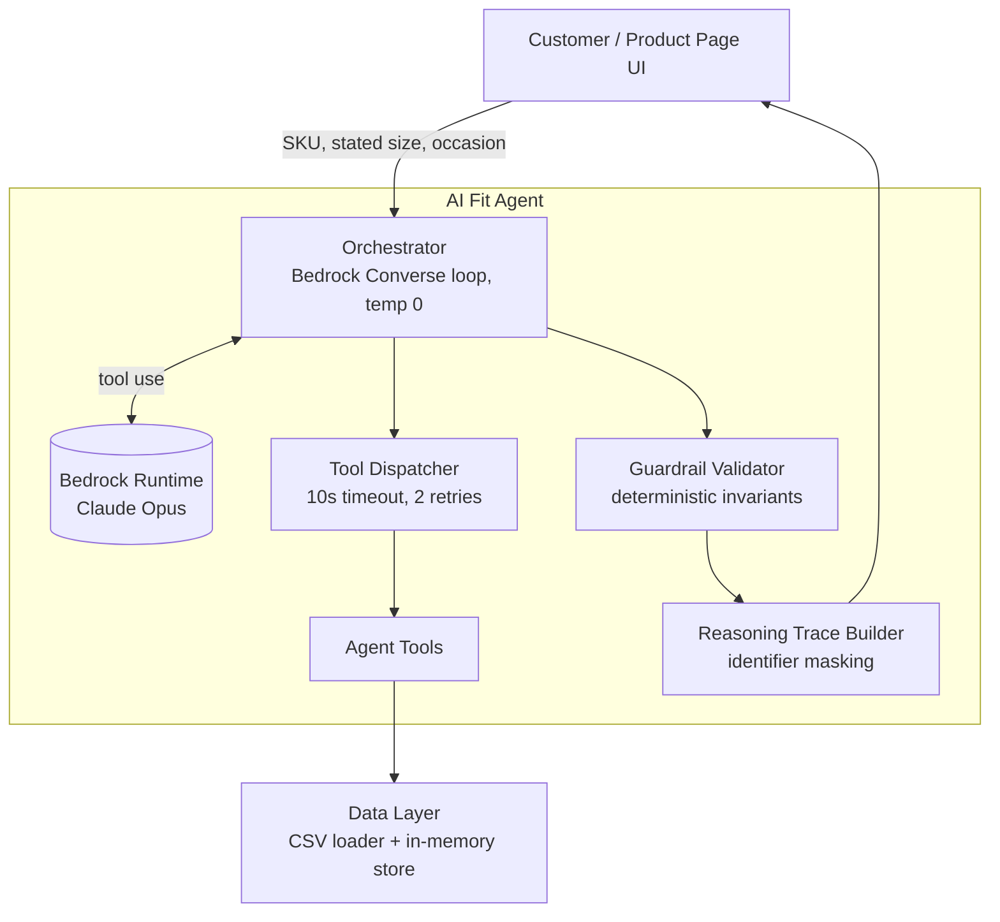

# AI Fit — Ascent Team

> 🏆 **1st Place, ALDO Retail Hackathon** — the Ascent team won the hackathon and a **$6,000** team prize.

AI Fit is an agentic AI assistant that helps ALDO shoppers find their *better fit* right on the product page. It recommends the right size for a specific SKU from historical fit-return and exchange signals, checks whether a shoe suits the occasion the customer is shopping for (and suggests alternative styles when it doesn't), and gives the product team a report of SKUs with possible quality problems.

The agent runs on **AWS Bedrock** with **Claude Opus** as the reasoning model, using the Bedrock Converse API with tool use. Claude decides which data tools to call, reads the records they return, and reasons over them. No dataset is stuffed into the prompt.

---

## The problem and our thesis

Fit is one of the biggest drivers of footwear returns. Every "too big", "too small" or "uncomfortable" return costs ALDO shipping, restocking and handling, and it leaves the customer disappointed. Size charts and generic "runs small" notes don't account for how a specific SKU actually performed with real customers, or for a shopper's own fit tendencies.

**Thesis:** if the customer gets a SKU-specific size recommendation and an occasion check *before* buying, built on what past customers actually returned and exchanged, ALDO can cut fit-related returns, which **improves gross margin**, while customers get shoes that fit and suit the occasion, which **improves customer satisfaction**.

---

## What the agent does

| Capability | Description |
|---|---|
| **Size recommendation** | Weighs OMS fit returns, in-store exchanges, the customer's fit profile, foot measurement, catalog fit guidance, reviews and past recommendation outcomes, then returns a recommended size, a confidence level (high / medium / low) and a plain-language explanation. |
| **Occasion matching** | Maps the customer's occasion (everyday wear, work or special occasion) against the product's catalog occasions and review cues. |
| **Alternative styles** | When the browsed product doesn't suit the occasion, suggests catalog styles that do. |
| **Width and comfort warnings** | Flags toe-box or width mismatches without changing the size. |
| **Outcome learning loop** | Records whether recommendations were kept or returned and feeds that back as a fit signal. |
| **Product quality report** | Flags SKUs with ≥ 5 quality returns, or a quality-return rate ≥ 5% with ≥ 30 units sold, for the product team. |
| **Human routing** | Sends any refund, discount, price change or order modification to a human reviewer and writes an audit log entry. |

### Agent tools

Each data source has its own tool (`ai_fit/tools/`):

- `get_sku_fit_signals`: fit-related returns and exchanges for a SKU
- `get_customer_profile`: sizing system, usual size, fit tendencies, comfort/style priority, foot measurement
- `get_product_catalog_entry`: offered sizes, fit guidance, fit return rate, toe box, occasions
- `get_sku_reviews`: review fit, width and occasion signals
- `get_recommendation_outcomes`: results of past recommendations for the SKU
- `find_alternative_styles`: occasion-appropriate alternatives
- `record_recommendation_outcome`: writes to the outcome store
- `get_quality_returns_and_units` / `generate_quality_issue_report`: product-quality reporting
- `route_to_human_reviewer`: hands off financial actions and logs them

---

## Architecture



**Claude reasons, guardrails enforce.** Claude Opus decides the size and confidence under a strict scoring rubric in the system prompt, at temperature 0. A deterministic **Guardrail Validator** then checks the output and corrects or rejects any violation before it reaches the customer. The validator enforces these rules:

- **Signal precedence:** a foot measurement sets the size; other signals only adjust confidence and warnings.
- **Net half-size cap:** non-measurement signals never stack into more than a half-size change.
- **Sparse-data fallback:** with fewer than 5 fit and exchange signals, the agent recommends the stated size at low confidence.
- **Confidence tiers:** 5–14 signals give medium confidence and 15 or more give high, with capped adjustments.
- **Size range:** recommendations are clamped to the sizes the SKU is actually offered in.
- **Required tools:** any recommendation made without calling the required tool is rejected.

The thresholds come from our analysis of the Feb 2024 – Feb 2026 return dataset (median fit signals per SKU is 2) and are meant to be re-tuned as outcome data accumulates.

---

## Responsible AI

| Concern | How AI Fit handles it |
|---|---|
| **Fairness and bias** | Protected attributes (age, gender, ethnicity, nationality, location) are removed from inputs. Sizing system is used as a sizing scale, not as personal gender. Identical signals always produce identical recommendations. |
| **Privacy** | `customer_uid` and `cnsmr_prof_sid` are masked in every reasoning trace, and order numbers are hashed in the outcome store. Customer profiles are synthetic. |
| **Explainability** | Every recommendation cites at least one historical signal and comes with a readable reasoning trace showing the tools called, the data retrieved and the decision. |
| **Financial authority** | The agent has none. It only presents recommendations. Refunds, discounts and order changes are declined and routed to a human reviewer with an audit log entry. |
| **Human oversight** | Low-confidence results are labelled advisory, with the final decision left to the customer. Reasoning traces are available to human reviewers. |

---

## Repository structure

```
Ascent/
├── ai_fit/                      # Core agent package
│   ├── config.py                # Bedrock model, region, temperature, timeouts, dataset paths
│   ├── demo.py                  # CLI demo of the full orchestrator path
│   ├── orchestrator/            # Bedrock Converse tool-use loop + tool dispatcher
│   ├── reasoning/               # Rubric, sizing, occasion normalization, parser, Guardrail Validator
│   ├── tools/                   # Agent tools (read, alternatives, outcomes, quality report, human routing)
│   ├── trace/                   # Reasoning trace builder with identifier masking
│   └── data/                    # CSV loader, mappers, in-memory store
├── ai_fit_demo_ui/              # Flask service + static product-page demo UI
│   ├── service.py               # /api/recommendation, /api/alternatives, /api/config
│   └── static/                  # index.html, app.js, styles.css, product images
├── tests/                       # pytest + Hypothesis property-based tests, JS DOM tests
├── .kiro/specs/                 # Requirements, design and task specs (ai-fit, ai-fit-demo-ui)
├── ALDO_FIT_Final_Synthetic_Customer_Profiles.csv
├── Synthetic_Customer_Reviews.csv
├── Synthetic_product_skus.csv
├── pyproject.toml
└── requirements.txt
```

---

## Data

| Dataset | In repo | Notes |
|---|---|---|
| `ALDO_FIT_Final_Synthetic_Customer_Profiles.csv` | ✅ | 500 synthetic customer fit profiles |
| `Synthetic_Customer_Reviews.csv` | ✅ | ~560 synthetic reviews with fit, width and occasion fields |
| `Synthetic_product_skus.csv` | ✅ | ~2,500 SKUs with fit guidance, toe box and occasions |
| `OMS Data_Feb24-Jan26_new.csv` | ❌ | OMS returns (fit and quality reasons) |
| `All OMS orders_Feb 2024 to Feb 2026.csv` | ❌ | OMS orders (units sold) |
| `McGill_Instore_return_exchanges.csv` | ❌ | In-store returns and exchanges |

The three OMS and in-store files were provided by ALDO for the hackathon. They are too large for GitHub and not for public release, so they are git-ignored. To run against live data, place them in the repository root under the filenames above (see `ai_fit/config.py`). Without them, use **stub mode**.

---

## Getting started

**Requirements:** Python 3.10+. Live mode also needs AWS credentials with Bedrock access to Claude Opus.

```bash
git clone https://github.com/yanling-lu/Ascent.git
cd Ascent
python -m venv .venv && source .venv/bin/activate
pip install -e .            # or: pip install -r requirements.txt
```

### Run the web demo

```bash
python -m ai_fit_demo_ui --stub          # offline, no AWS needed
python -m ai_fit_demo_ui                 # live Bedrock (Claude Opus)
python -m ai_fit_demo_ui --host 0.0.0.0 --port 8000
```

Then open `http://127.0.0.1:5000`. The demo shows a product page for the *Aahliyah* boot (SKU 15887957) with synthetic customer `ALDO_SYN_0005` shopping for work. It includes the size recommendation, the fit insight, alternative styles for the occasion and a live activity trace of the agent's reasoning.

### Run the CLI demo

```bash
python -m ai_fit.demo --stub             # or AI_FIT_DEMO_STUB=1 python -m ai_fit.demo
```

This prints the explanation, confidence, occasion match and masked reasoning trace.

### Configuration

Model and region defaults are set in `ai_fit/config.py` (`us-east-1`, temperature 0, 10 s tool timeout, 2 retries). They can be overridden with `AI_FIT_*` environment variables.

---

## Testing

```bash
pytest
```

The suite uses **Hypothesis** property-based tests to check the guardrails: the half-size cap, measurement precedence, OMS dominance, confidence caps, offered-size clamping, protected-attribute exclusion, validator determinism, trace masking and quality-report flagging. It also has integration tests for the Converse loop and the demo UI. JavaScript DOM tests for the front end are in `tests/js/`.

---

## Hackathon deliverables

The final round (October 15–16) required a working prototype and an 8-minute pitch to a jury. AI Fit covers each deliverable:

1. **Problem and thesis:** fit-driven returns hurt both gross margin and customer satisfaction.
2. **Agentic approach:** Claude Opus has its own tools, makes the decisions, and hands anything outside its authority to a human.
3. **Working prototype:** an end-to-end product-page scenario with visible reasoning.
4. **Business impact:** fewer fit returns and lower restocking costs, plus quality-issue flags for the product team.
5. **Responsible AI:** fairness, privacy, explainability, bounded financial authority and human oversight are built in and covered by tests.

---

*All customer profiles and reviews in this repository are synthetic (`SYNTHETIC_NOT_REAL_ALDO_CUSTOMERS`). This project was built for the ALDO Retail Hackathon and is not an official ALDO product.*
